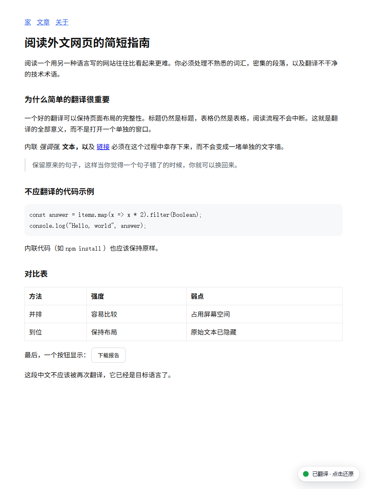
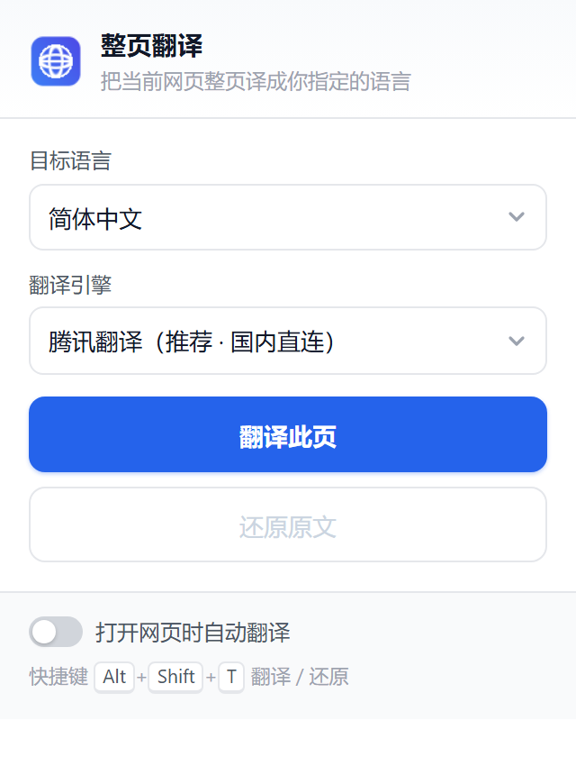

# 整页翻译 · Page Translator

点一下，把当前网页**整页翻译**成你指定的语言，原版式保留，随时一键还原。

An open-source browser extension that translates the whole page in place — no API key, no sign-up, no account.



- 免注册、免 API Key、免费
- 支持 Chrome / Edge（Chromium 内核）与 Firefox
- 12 种目标语言，默认简体中文
- 代码块、输入框、脚本不翻译
- 懒加载 / 无限滚动出现的新内容会自动补翻
- 翻译后可一键还原，原文逐字符一致

---

## 一、安装

### 方式 A：下载安装包（不用装 Python）

到 [Releases](../../releases) 页面下载最新的 `page-translator-chrome-v*.zip` 或 `page-translator-firefox-v*.xpi`，解压后按下面的步骤加载。

### 方式 B：从源码构建

只需要 Python 3（**零第三方依赖**，标准库即可）：

```bash
git clone https://github.com/<你的用户名>/page-translator.git
cd page-translator
python build.py
```

跑完会得到 `dist/chrome`、`dist/firefox` 两个可直接加载的目录，以及两个打包文件。

### Edge / Chrome

1. 地址栏打开 `edge://extensions/` 或 `chrome://extensions/`
2. 打开「**开发人员模式**」（Edge 在左下角，Chrome 在右上角）
3. 点「**加载解压缩的扩展**」/「**加载已解压的扩展程序**」，选择 `dist/chrome` 目录
4. 工具栏出现蓝色地球图标即安装完成（建议点图钉固定出来）

### Firefox

1. 地址栏打开 `about:debugging#/runtime/this-firefox`
2. 点「**临时载入附加组件**」
3. 选择 `dist/firefox/manifest.json`

> 临时载入的扩展在 Firefox 重启后会消失，需重新载入。要长期保留得提交签名，或使用 Developer Edition / Nightly 并关闭签名校验。

> Firefox 至今不支持 MV3 的 `background.service_worker`，所以 Firefox 版是 MV2 清单。**装错版本的表现是「点翻译没反应」**——后台根本没跑起来。

---

## 二、怎么用

| 操作 | 效果 |
| --- | --- |
| 点工具栏图标 → 「翻译此页」 | 整页翻译成下拉框里选的语言 |
| 点「还原原文」 | 恢复成原始文字，一个字符都不差 |
| `Alt` + `Shift` + `T` | 翻译 / 还原，来回切换 |
| 页面右下角提示条「已翻译 · 点击还原」 | 直接点它也能还原 |
| 勾选「打开网页时自动翻译」 | 以后每个外语页面自动开翻 |

弹窗里还能改：

- **目标语言**：简体中文 / 繁體中文 / English / 日本語 / 한국어 / Français / Deutsch / Español / Русский / Português / Italiano / العربية
- **翻译引擎**：腾讯翻译（默认）/ MyMemory（备用）/ Google（需能访问外网）

<p align="center"></p>

---

## 三、翻译引擎与隐私

默认走**腾讯交互翻译**的公开接口（`transmart.qq.com`）：国内直连、免 Key、单次可提交数十段、自动识别源语言。主引擎出错会自动降级到 MyMemory 兜底。

需要知道的一点：**待翻译的文字会被发送到对应服务商的服务器**——这是任何在线翻译都绕不开的。扩展不上传浏览记录、不含统计埋点，所有设置只存在浏览器本地的 `storage.local` 里。

---

## 四、已知限制

1. **浏览器内置页面翻不了**：`chrome://`、`edge://`、扩展商店、PDF 阅读器等不允许注入脚本，会提示「请换普通网页试试」。
2. **本地 HTML 文件**：需要在扩展详情里打开「允许访问文件网址」，否则 `file://` 页面不会自动注入。
3. **一种语言一次**：翻译后如果又切换目标语言，先点「还原原文」再翻，否则只会补翻新出现的内容。
4. **代码不翻**：`<pre>` `<code>` `<kbd>` 内的内容原样保留。
5. **整句连读的取舍**：同一段落里被 `<strong>`/`<em>` 等行内标签切碎的文字，会先合并成整句翻译、再按原片段长度比例分回原位——所以句子一定通顺完整，但加粗/斜体的起止位置可能偏移几个字；跨链接的文字不合并，链接文字会单独翻译。
6. **框架页只翻主文档**：`iframe` 里的内容不处理。

---

## 五、排障：装错版本会怎样

看到 `browser.tabs.executeScript is not a function` 就是这个原因：

**Chromium（Chrome / Edge）也会暴露一个 `browser` 对象**，所以不能靠「有没有 `browser`」判断浏览器类型。v1.0.0 按这个判断，于是在 Edge 里走进了 Firefox 的注入分支，而 MV3 下 `tabs.executeScript` 早已被移除。

v1.0.1 起改为**按能力判断**：有 `scripting.executeScript` 就用它（MV3），没有再退回 `tabs.executeScript`（MV2）；`chrome.*` / `browser.*` 的回调式与 Promise 式也统一封装。两个浏览器版本走同一套代码。

如果仍然报错，检查一下装的是不是对应的包：

| 你的浏览器 | 该加载的目录 |
| --- | --- |
| Edge / Chrome | `dist/chrome`（MV3） |
| Firefox | `dist/firefox`（MV2） |

---

## 六、目录结构

```
page-translator/
├─ src/                     扩展源码（一份源码出两个浏览器版本）
│  ├─ manifest.chrome.json  MV3 清单（Chrome / Edge）
│  ├─ manifest.firefox.json MV2 清单（Firefox）
│  ├─ shared.js             语言表、设置读写、跨浏览器 API 封装
│  ├─ background.js         真正的翻译请求 + 多引擎降级 + 缓存
│  ├─ content.js            取文字、合并整句、原地替换、还原、动态补翻
│  ├─ popup.html/css/js     弹窗界面
│  └─ icons/                图标（由 build.py 生成）
├─ dist/                    构建产物，不入库（见 .gitignore）
├─ docs/                    截图
├─ test/                    自动化测试（Edge 无头模式 + CDP）
└─ build.py                 重建图标 + 组装 dist + 打包
```

改完 `src/` 里的任何文件，跑一次 `python build.py`，然后在扩展管理页点「重新加载」即可。

---

## 七、发版

版本号只有一处真相源：`src/manifest.chrome.json` 与 `src/manifest.firefox.json` 里的 `version`。`build.py` 直接读它，不需要再改别的地方。

发一个新版本：

```bash
# 1. 把两个 manifest 的 version 都改成新版本，比如 1.0.2
# 2. 本地先验一遍
python build.py && python verify_dist.py

# 3. 提交并打 tag
git add -A && git commit -m "release: v1.0.2"
git tag v1.0.2
git push && git push --tags
```

推上 tag 之后，GitHub Actions 会自动完成：

1. **校验 tag 与 manifest 版本一致** —— 不一致直接失败，避免发出错版本的包
2. 构建 Chrome / Firefox 两个包
3. **校验产物结构** —— 文件是否齐全、版本号是否正确、MV3 与 MV2 有没有装反
4. 生成 `SHA256SUMS.txt`
5. 创建 Release 并上传三个文件

也可以在 Actions 页面手动触发（Run workflow），填入 tag 补发或重发。

构建是**可复现**的：同一份源码在本地和 CI 产出的包，SHA256 完全相同 —— 即使是 Windows + Python 3.13 对 Ubuntu + Python 3.12。所以 `SHA256SUMS.txt` 可以用来校验下载的文件有没有被改动。

---

## 八、想换个引擎？

`src/background.js` 里加一个函数，再注册进 `ENGINES` 就行：

```js
async function viaYoudao(texts, lang) {
  // texts: 字符串数组；lang.tencent / lang.google 等是各引擎的语言代码
  // 返回 { results: [...与原数组同长度], src: 'en' }
}

const ENGINES = { tencent: viaTencent, mymemory: viaMyMemory, google: viaGoogle, youdao: viaYoudao };
```

再加到 `shared.js` 的 `PROVIDERS` 里，弹窗下拉框自动出现这一项。要接大模型（OpenAI / DeepSeek 等），照着 `viaGoogle` 的结构写一个、把 API Key 存在设置里即可。

---

## 九、测试

`test/` 下是**真链路**测试：真浏览器 + 真接口，不是 mock。

```bash
# 1. 起一个本地测试页
python -m http.server 8123 --directory test

# 2. 另开一个终端，起无头 Edge（带扩展）
msedge --headless=new --remote-debugging-port=9333 \
  --user-data-dir=/tmp/edge-pt \
  --load-extension="$PWD/dist/chrome" about:blank

# 3. 跑测试
node test/smoke.mjs        # content.js 逻辑：翻译 / 结构完整 / 代码不翻 / 还原
node test/e2e-ext.mjs      # 走扩展自身的 background + 真实接口
node test/popup-path.mjs   # 弹窗点「翻译此页」那条函数链（曾报 executeScript 错）
node test/check-ext.mjs    # 扩展能否被加载 + 弹窗渲染截图
node test/diag.mjs         # 打印扩展上下文里 browser / chrome 的真实形态
```

当前结果：`smoke` 8/8、`e2e-ext` 6/6、`popup-path` 6/6 通过。

---

## 十、免责声明

- 腾讯交互翻译、MyMemory 均为第三方服务，本扩展调用的是其**面向网页的公开接口**，并非官方开放 API，接口随时可能变更或失效；由此产生的可用性问题不作为 bug 承诺修复，但欢迎提 issue。
- 请勿用于翻译违反当地法律法规的内容，也不要用脚本高频调用这些接口。
- 本项目与腾讯、Google、MyMemory 均无隶属关系。

## 十一、License

[MIT](LICENSE)
